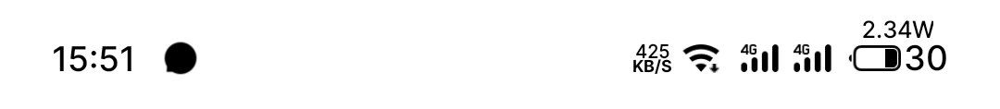
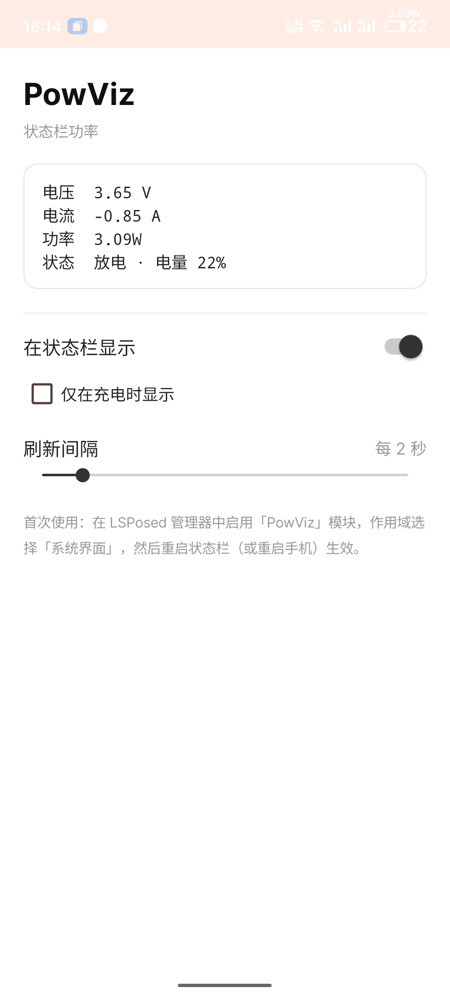

# PowViz

在状态栏电池图标上方实时显示当前功率（瓦特）的 LSPosed 模块，附带一个白色风格的设置 App。

功率文字与电池图标、电量数字组成一个整体：图标和百分比靠拢在一起，功率以小号字居中显示在它们正上方，颜色随状态栏图标自动切换（浅色背景黑色、深色背景白色），并逐帧跟随系统的变色过渡。

> **支持设备**：MEIZU 20 / Flyme 11.2.1（Android 14）已验证；其他品牌 ROM 暂不支持（hook 依赖 Flyme 的电池视图与状态栏布局）。

## 截图

| 浅色状态栏 | 深色状态栏 |
| :---: | :---: |
|  |  |
| 功率文字随图标变为黑色 | 深色背景下自动变为白色 |

<p align="center">
  
</p>


## 功能

- 状态栏电池图标正上方显示实时功率，如 `2.34W`
- 字体、颜色自动匹配系统状态栏（跟随电量数字/时钟）
- 可在「仅充电时显示」与始终显示之间切换
- 刷新间隔 1–10 秒可调（默认 2 秒），状态栏与 App 预览同步生效
- 不依赖常驻后台服务，功率数据直接取自系统电池服务

## 工作原理

- 通过 LSPosed 在 SystemUI 进程中 hook `com.flyme.statusbar.battery.FlymeBatteryMeterView`
- 把电池图标与 `battery_percent` 收进同一个槽位，功率 `TextView` 居中放在槽顶部
- 功率 = 电池电压（`ACTION_BATTERY_CHANGED` 的 `voltage`，mV）× 瞬时电流
  （`BatteryManager.BATTERY_PROPERTY_CURRENT_NOW`，µA）的绝对值
- 颜色：hook `TextView.setTextColor`，当电量数字/时钟变色时同步给功率文字
- 配置：App 通过 `ContentProvider`（`com.aicode.powerbar.config`）提供开关与间隔，
  模块启动时读取，变更时通过广播即时下发

## 兼容性

当前适配 **MEIZU 20 / Flyme 11.2.1（Android 14）**。模块依赖 Flyme 的状态栏类名与
`system_icons` 布局，其他 ROM 需要在 `XposedInit.java` 中替换 hook 的视图类，并确认
`BatteryManager` 能返回瞬时电流。

## 构建

需要 JDK、Android SDK：

- build-tools `35.0.0`
- platform `android-34`

```sh
cd statusbar-power
sh build.sh
```

产物：`statusbar-power/build/statusbar-power.apk`。首次构建会自动生成 `debug.keystore`
（已在 `.gitignore` 中排除）。

## 安装与启用

1. 安装 `statusbar-power.apk`
2. 在 LSPosed 管理器中启用 **PowViz** 模块，作用域勾选 **系统界面**（`com.android.systemui`）
3. 重启状态栏（或重启手机）
4. 打开 PowViz，打开「在状态栏显示」，按需调整刷新间隔

## 目录结构

```
statusbar-power/
├── AndroidManifest.xml        # 模块声明 + 设置页 + 配置 Provider
├── assets/xposed_init         # LSPosed 模块入口
├── build.sh                   # aapt2 + javac + d8 + apksigner 构建脚本
├── res/                       # 应用资源与主题
├── src/com/aicode/powerbar/
│   ├── XposedInit.java        # SystemUI 注入、功率计算、颜色同步
│   ├── MainActivity.java      # 白色主题设置页
│   ├── PowerConfigProvider.java
│   ├── PowerFormat.java
│   └── Prefs.java
└── xposed-api/                # 编译用的 Xposed API 桩类（不打包）
```

## 说明

- 不联网、不收集任何数据
- 仅用于在状态栏展示读取到的电池数据
